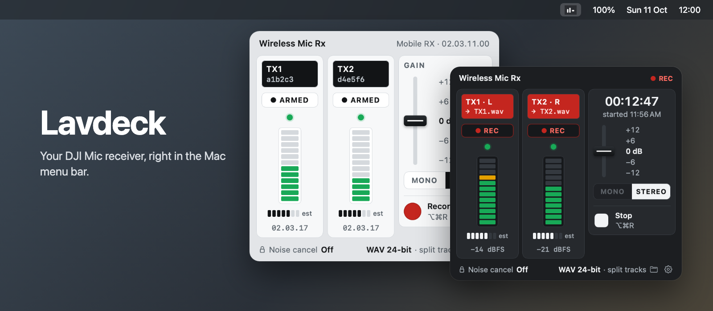
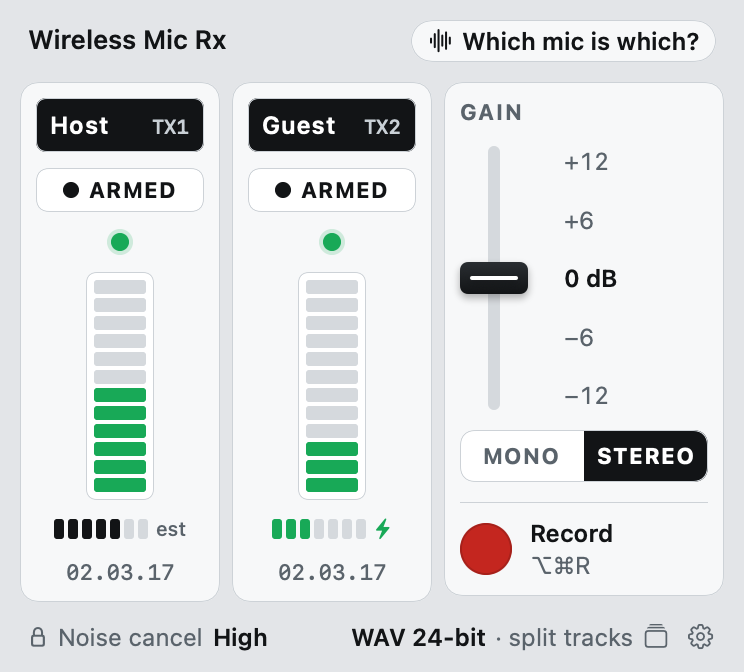
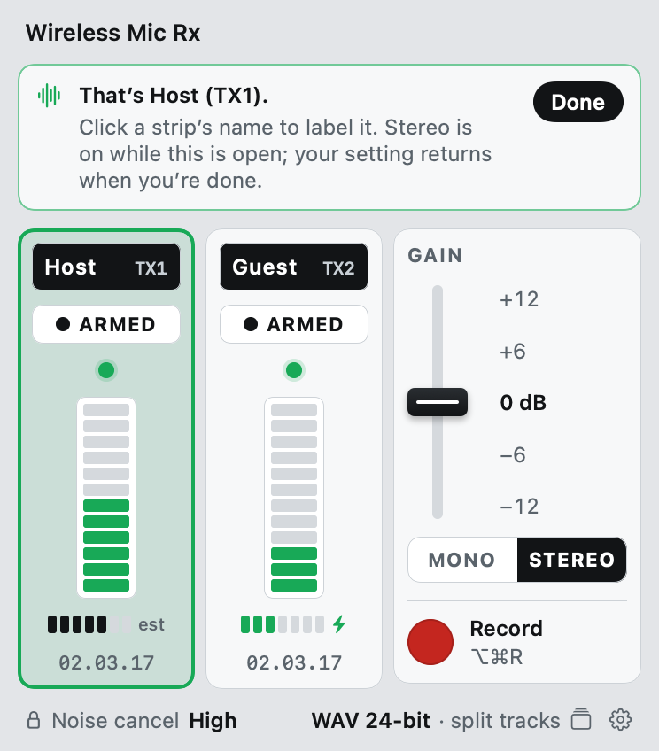
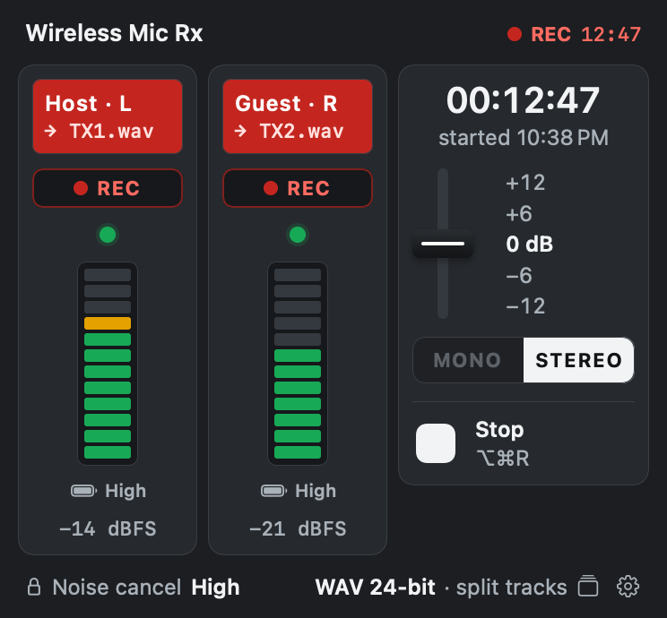
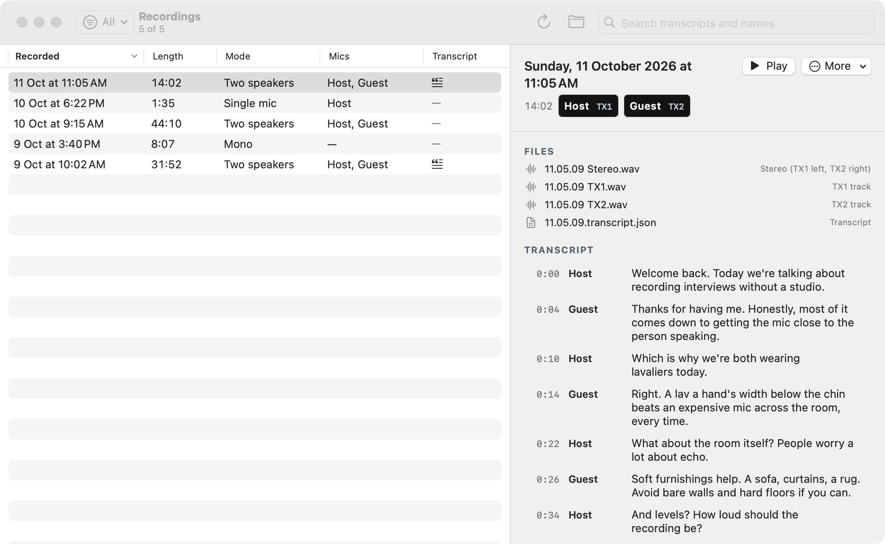

<p align="center">
  
</p>

<h1 align="center">Lavdeck</h1>

<p align="center">
  <b>A native macOS menu bar app for the DJI Mic Series Mobile RX.</b><br>
  Plug the receiver in, and your mics' status, settings and recording are one click away.
</p>

<p align="center">
  
  
  
</p>

---

## Why this exists

DJI's wireless mics sound great. Managing them from a Mac does not.

- **DJI Studio, DJI's Mac app, doesn't support the mics at all.** It imports footage from DJI cameras; plug in the mic receiver and there is nothing to see, nothing to set.
- **The only way to change settings is DJI Mimo,** a 1.4 GB phone app built around cameras and gimbals. Stereo, gain and battery status sit behind pairing screens and menus that have nothing to do with the microphone you are trying to use.
- **The receiver itself has no button for stereo or gain.** So switching modes before a call or a recording means reaching for your phone, every time.

Lavdeck talks to the receiver directly over USB. Plug it into your Mac and within seconds you can see both mics, switch mono and stereo, set gain and hit record, all from the menu bar. No phone, no account, no 1.4 GB.

## What it does

<p align="center">
  
  &nbsp;
  
  &nbsp;
  
  <br><sub>Named mics with charging state · finding which mic is which · recording in stereo</sub>
</p>

- **Live status for every mic:** link light, level meter, whether it's charging, and firmware for TX1 and TX2, straight from the receiver.
- **Noise cancelling at a glance:** shows whether the receiver's switch is on Off, Low or High.
- **Mono / stereo** with one click. In stereo, TX1 is left and TX2 is right.
- **Receiver gain** on a five‑detent fader: −12, −6, 0, +6, +12 dB.
- **Recording** to 24‑bit WAV (or M4A), into a dated folder with no save dialog.
- **Separate tracks:** in stereo, save each mic as its own file next to the stereo take.
- **Pick your mics:** arm one or both. With one armed, only that mic is recorded.
- **Which mic is which?** Click it and talk into a mic: its strip lights up. Name each mic (say "Host" and "Guest") and the name follows that physical mic.
- **Start and stop anywhere:** the Record button, <kbd>⌥</kbd><kbd>⌘</kbd><kbd>R</kbd>, or a tap on either mic's link button (without changing your Mac's volume). The elapsed time sits next to REC, and Stop is always on screen while recording, even if the receiver drops.
- **Takes survive quitting:** quit Lavdeck mid‑take (or let macOS "Quit & Reopen" it after a permission change) and the take is stopped and saved first.
- **Recordings window:** every take in one list, with the first words of its transcript and a badge when it has video. Filter, sort and search by words, mic names or date. Watch a take's video right there (or its raw screen or camera recording with the mic audio lined up), scrub its audio, follow along in the transcript and click any line to jump there. Drag a file out to another app, share the take, or move it to the Trash with all its files.
- **Work on many takes at once:** ⌘-click, ⇧-click a range or ⌘A, then transcribe them (or just the ones without a transcript), copy their transcripts as text, show them in Finder or move them to the Trash. Plugin jobs queue and run one take at a time.
- **Plugins:** add what happens alongside or after a recording, such as transcripts, screen and camera capture, or an editor, written in any language. See [Plugins](#plugins).
- **Screen and camera in one click:** with a capture plugin installed, SCREEN and CAMERA buttons on the deck choose what records with the next take, no trip to Settings.
- **A menu bar icon that tells you what's wrong** before you open anything:

<p align="center">
  
  <br><sub>Healthy · recording · a mic dropped · low battery (for receivers that report it) · error · no receiver (light and dark menu bars)</sub>
</p>

<p align="center">
  
</p>

It also recovers on its own when you unplug and replug the receiver, follows light and dark appearance, and labels every control for VoiceOver.

## Install

Lavdeck isn't notarized yet, so for now you build it from source. It takes about a minute.

**Requirements:** macOS 15 or later, Xcode 16 (Swift 6) or later.

```bash
git clone https://github.com/piedol/lavdeck.git
cd lavdeck
scripts/build-app.sh
cp -R build/Lavdeck.app /Applications/
open /Applications/Lavdeck.app
```

**Keep permissions across rebuilds (optional).** The build is signed ad hoc by default, which changes with every build, so macOS asks again for microphone, camera and screen recording each time you rebuild. To avoid that, create a local signing certificate once; `build-app.sh` uses it automatically:

```bash
printf '[req]\ndistinguished_name=dn\nx509_extensions=ext\nprompt=no\n[dn]\nCN=Lavdeck Local Signing\n[ext]\nbasicConstraints=critical,CA:false\nkeyUsage=critical,digitalSignature\nextendedKeyUsage=critical,codeSigning\n' > /tmp/lavdeck-cert.cnf
/usr/bin/openssl req -x509 -newkey rsa:2048 -nodes -keyout /tmp/lavdeck.key -out /tmp/lavdeck.pem -days 3650 -config /tmp/lavdeck-cert.cnf
/usr/bin/openssl pkcs12 -export -inkey /tmp/lavdeck.key -in /tmp/lavdeck.pem -name "Lavdeck Local Signing" -out /tmp/lavdeck.p12 -passout pass:lavdeck
security import /tmp/lavdeck.p12 -k ~/Library/Keychains/login.keychain-db -P lavdeck -T /usr/bin/codesign
rm /tmp/lavdeck.key /tmp/lavdeck.p12
```

Or set `LAVDECK_SIGN_IDENTITY` (or put the name in a git-ignored `.signing-identity` file) to any code-signing identity you already have. macOS is most reliable about screen recording permission with a trusted identity such as an Apple Development or Developer ID certificate. The certificate stays on your Mac and is only used to sign your own build.

Plug in the receiver (a USB hub must carry data, not just power) and click the icon in the menu bar. macOS asks for microphone access the first time you record.

## Using it

| To | Do |
|---|---|
| Switch mono / stereo | Click **MONO** or **STEREO** in the popover |
| Change gain | Drag the fader or click a value |
| Tell the mics apart | **Which mic is which?**, then talk into one; click a strip's name to label it |
| See if a mic is charging or full | Under each meter: ⚡ Charging, or the receiver's battery level (High) |
| Record only one mic | Click **ARMED** on the other strip to turn it **OFF** |
| Start / stop recording | **Record**, <kbd>⌥</kbd><kbd>⌘</kbd><kbd>R</kbd>, or tap a mic's link button |
| Find your takes | Click the format label in the popover to open **Recordings**, or look in `~/Recordings/Lavdeck/<date>/` |
| Search or transcribe old takes | **Recordings**: type in the search field, or **More › Generate transcript** (needs a transcription plugin) |
| Open a take in an app plugin | **Recordings** › select a take › **Open in …** |
| Turn plugins on and allow what they need | Gear icon › **Plugins** |
| Change format, folder, tracks, login item | The gear icon |

Noise cancelling stays on the receiver's physical **O / L / H** switch; Lavdeck shows which position it's in.

There's also a small command‑line tool for scripting and debugging:

```bash
swift build -c release
.build/release/lavdeck status --json    # live status, read-only (charging, levels, settings)
.build/release/lavdeck set channel stereo
.build/release/lavdeck takes             # list recorded takes
.build/release/lavdeck plugins           # list installed plugins
.build/release/lavdeck run <plugin-id> <action> <take-id>   # run a plugin action on a take
```

## Plugins

Plugins add steps that run after a take is recorded, never during it, so they can't cost you a recording. A plugin is a folder with a small `plugin.json` and a program in any language. Lavdeck sends it the take as JSON and shows the plugin's progress in the menu bar and the Recordings window. Its settings appear in **Settings › Plugins**, and its actions appear on every take in the Recordings window.

- **Events:** run automatically when a recording finishes, for example to transcribe every take.
- **Capture:** record alongside the mic, for example the screen and a webcam. Lavdeck notes when each file's first frame happened relative to the audio, so every file lines up to the frame.
- **Actions:** run on demand on any take, old or new, for example **Generate transcript**.
- **Apps:** a plugin can ship a companion app, such as an editor; every take gets an **Open in …** button.
- **Shared formats:** a plugin that writes the standard transcript JSON gets search, speaker names and click-to-play in the Recordings window for free.
- **One permission prompt, not one per plugin:** plugins never ask macOS for anything. They declare what they need (screen recording, camera), Lavdeck asks once and shows what's allowed in **Settings › Plugins**, and every plugin runs under Lavdeck's permissions.

Start from [`Examples/plugins/take-info`](Examples/plugins/take-info), which includes a one-file Python helper. The protocol is documented in **[docs/PLUGINS.md](docs/PLUGINS.md)**. A plugin runs with your permissions, so install only plugins you trust. Plugins are installed switched off.

## Compatibility

| Hardware | Status |
|---|---|
| DJI Mic Series **Mobile RX** + DJI Mic Mini transmitters | Tested |
| Mobile RX + DJI Mic Mini 2 / Mic 2 / Mic 3 transmitters | Likely; untested |
| Other DJI Mic receivers (clip‑on Mic Mini / Mic 2 RX) | Unknown; reports welcome |

**Known limits**

- **Coarse battery level only.** The Mobile RX passes on whether each mic is charging and a coarse battery code, not a percentage. Only the "high" code is mapped so far; other codes show as "Level N" and are logged to `~/Library/Logs/Lavdeck/battery.log`. A mic that was just in use can take a few minutes to start charging.
- In mono the receiver mixes both mics, so each strip shows the mixed level (labelled **mono mix**). Switch to stereo to see each mic's own level.
- The receiver accepts a per‑mic mute but doesn't act on it, so Lavdeck records one mic by keeping only its channel instead.
- The Mac can't tell which mic's button was tapped; either one toggles recording.
- **Firmware updates stay in DJI Mimo.** Lavdeck deliberately can't send them.

## Safety

The receiver has a firmware‑update channel on the same USB connection. Lavdeck can only send four verified commands (get version, get capabilities, set channel mode, set gain), and those are built by a closed allowlist with no way to send arbitrary bytes. See [docs/PROTOCOL.md](docs/PROTOCOL.md) for the full details.

## How it works

The receiver speaks DJI's DUML protocol on a vendor USB interface alongside its normal audio interface. Lavdeck reads the receiver's status pushes, sends a handful of settings commands, and records the receiver's standard USB audio with AVFoundation. The protocol, as far as it's been mapped, is documented in **[docs/PROTOCOL.md](docs/PROTOCOL.md)**, and the app's visual system in [DESIGN.md](DESIGN.md).

```
Sources/LavdeckKit        USB link, DUML framing, status decoder, allowlisted commands, recorder, take library, plugin and capture runners
Sources/LavdeckPluginKit  plugin protocol (post, capture and app plugins) and transcript types, usable by Swift plugins
Sources/LavdeckApp        SwiftUI menu bar app, Recordings window, plugin settings and permissions
Sources/lavdeck           command-line tool
Examples/plugins          example plugin with a Python helper
Tests                     decoder and framing tests on captured frames; take library, plugin, capture and app-plugin tests
```

## Contributing

Issues and pull requests are welcome, especially reports from other DJI receivers. If you have one, `lavdeck status --json` and `lavdeck caps` are read‑only and safe to run; please include their output.

## License

[Apache License 2.0](LICENSE). Fork it, change it, ship it, including commercially. If you redistribute Lavdeck or a derivative, keep the copyright and [NOTICE](NOTICE) file so the original project is credited.

Lavdeck is an independent project and is not affiliated with, endorsed by or sponsored by DJI. DJI, DJI Mic and DJI Mimo are trademarks of SZ DJI Technology Co., Ltd., used here only to describe compatibility.
