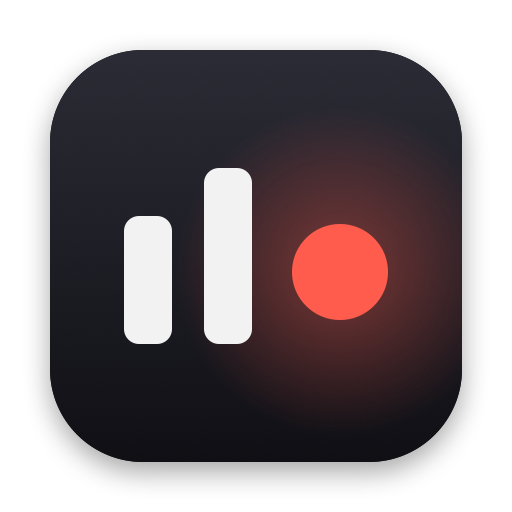
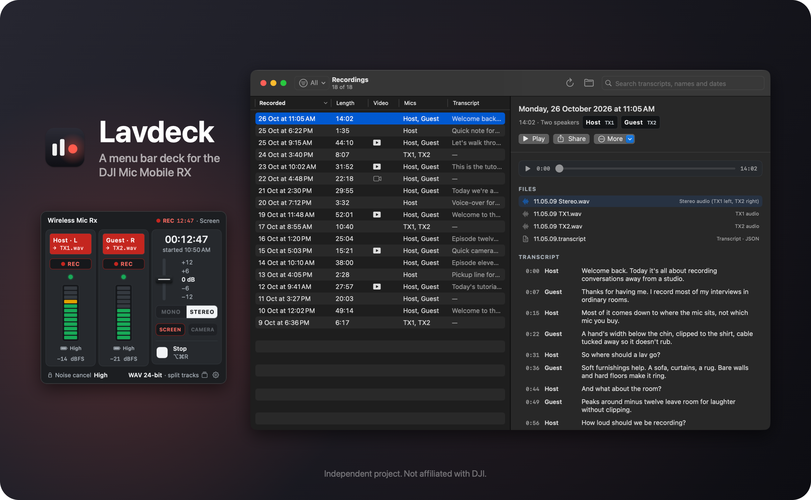
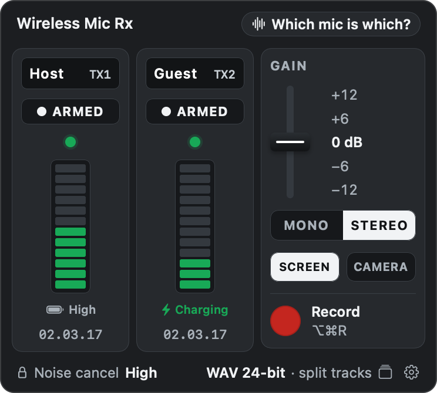
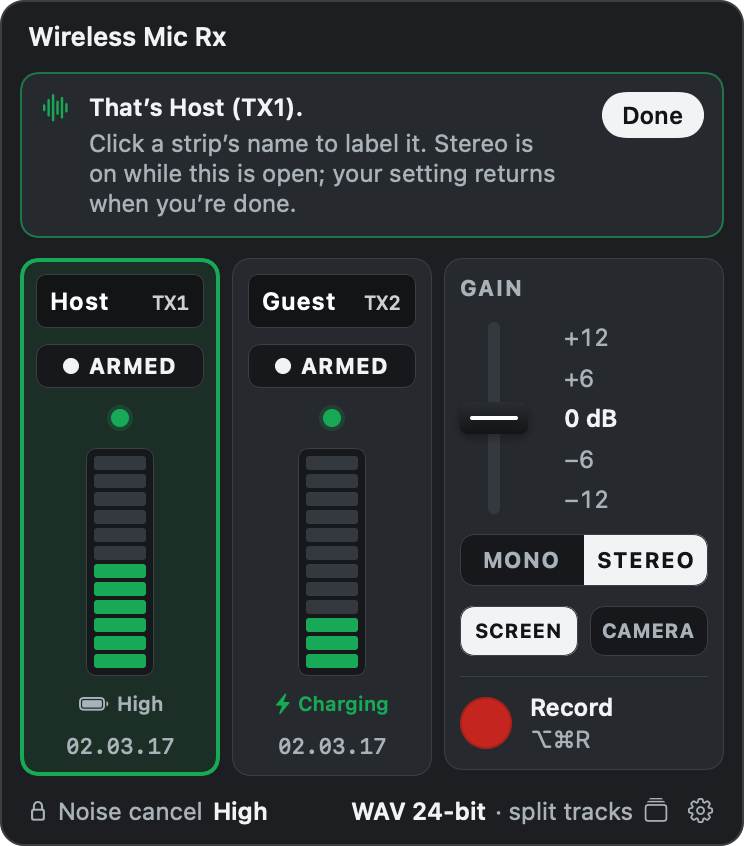
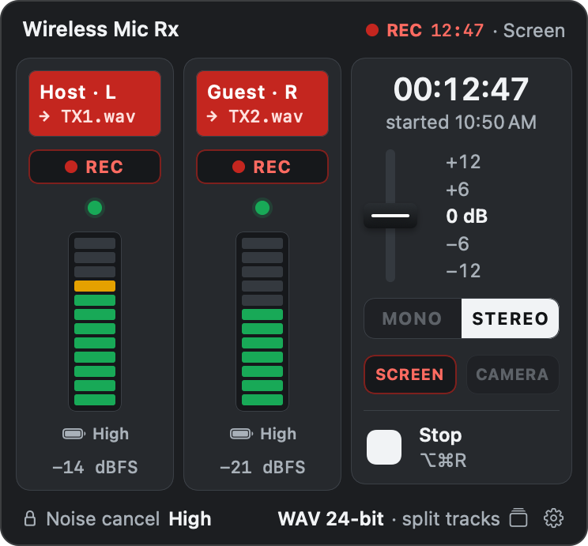
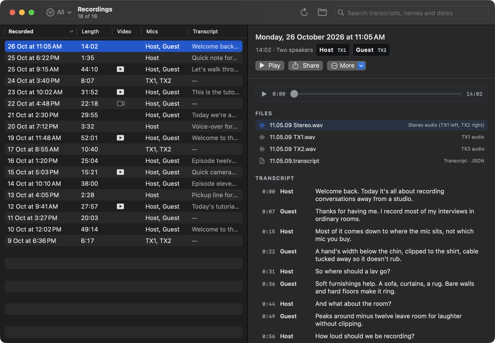
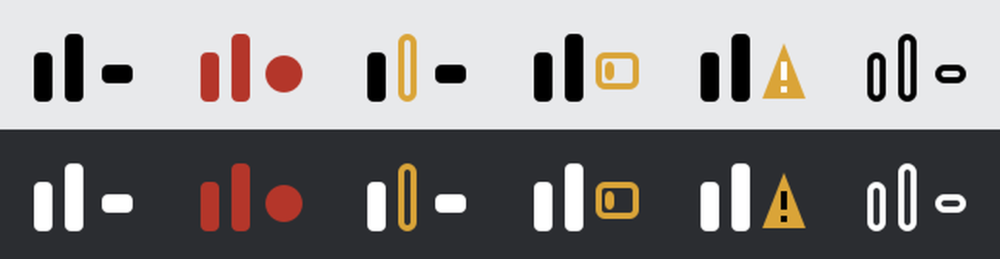

<p align="center">
  
</p>

<h1 align="center">Lavdeck</h1>

<p align="center">
  A menu bar deck for the DJI Mic Series Mobile RX: live mic status, mono or stereo, gain and recording.
</p>

<p align="center">
  
  <a href="LICENSE"></a>
</p>

<p align="center">
  
</p>

Lavdeck puts the DJI Mic Series Mobile RX in your Mac's menu bar. Plug the receiver into the Mac and the deck shows both transmitters: whether each one is linked, its live level, whether it's charging and its firmware. From the same window you switch the receiver between mono and stereo, set its gain from −12 to +12 dB, and record. In stereo each mic is saved as its own 24-bit WAV file as well as the stereo take.

Lavdeck can record your screen and camera with the mics, keeps every take in a searchable Recordings window, and runs plugins for jobs such as transcription. It talks to the receiver directly over USB and sends it only four commands, each checked on the hardware: get version, get capabilities, set channel mode and set gain.

Lavdeck is an independent project. It isn't made by DJI or affiliated with DJI.

<p align="center"><sub>The name joins <em>lav</em>, short for lavalier mic, and <em>deck</em>, as in a mixing desk.</sub></p>

## Contents

- [The deck](#the-deck) · [Which mic is which?](#which-mic-is-which) · [Recording](#recording) · [Screen and camera](#screen-and-camera)
- [Recordings](#recordings) · [The menu bar icon](#the-menu-bar-icon) · [Settings](#settings)
- [Requirements](#requirements)
- [Install](#install) · [Uninstall](#uninstall)
- [Privacy and permissions](#privacy-and-permissions)
- [Plugins](#plugins)
- [Troubleshooting](#troubleshooting)
- [Development](#development) · [Contributing](#contributing)
- [Credits](#credits) · [License](#license)

## The deck



Click the menu bar icon to open the deck. Each transmitter has a channel strip; the receiver's controls are on the right.

On each strip, from the top:

- The mic's name. Click it to rename the mic, up to 14 characters. The name is stored with the mic's Bluetooth ID, so it follows that physical mic whichever slot it links to.
- **ARMED** or **OFF**. Only armed mics are recorded.
- The link light: green while the mic is linked, an amber ring if it drops.
- A 12-step level meter. In stereo it shows that mic's level. In mono the receiver mixes both mics before the Mac sees them, so both meters show the mix and say **mono mix**.
- **Charging**, or the battery level the receiver reports. The Mobile RX passes on a coarse code rather than a percentage, and only its "High" code has been worked out so far.
- The firmware version, marked when one mic is behind the other.

On the right are the gain fader (−12, −6, 0, +6 and +12 dB), **MONO** and **STEREO** (stereo puts TX1 on the left channel and TX2 on the right), **SCREEN** and **CAMERA**, and **Record**. The footer shows the receiver's noise cancelling, which you set with the O, L and H switch on the receiver itself, and the recording format. Click the format to open Recordings, or the gear for Settings.

Right-click the menu bar icon for a short menu: start or stop recording, mono or stereo, Recordings, Settings and **Quit Lavdeck**.

<br clear="right">

## Which mic is which?



Click **Which mic is which?** and talk into one mic. Its strip lights up and the banner names it. Click a strip's name to label the mic while you're there.

Each mic's level is only separate in stereo, so Lavdeck switches the receiver to stereo while the banner is open and switches it back when you click **Done**, or after 45 seconds.

<br clear="right">

## Recording



Start and stop a take with **Record**, with **⌥⌘R** from any app, or by tapping the link button on either transmitter. While a take runs, each strip names the file it's writing, its meter shows the level being recorded with a dBFS readout, and the elapsed time sits at the top.

Takes go into a folder for each day, named by the time they started:

| Mode | Files |
|---|---|
| Stereo, both mics armed | `11.05.09 Stereo.wav`, plus `11.05.09 TX1.wav` and `11.05.09 TX2.wav` (WAV only; you can turn the separate files off) |
| Mono | `11.05.09 Mix.wav` |
| One mic armed | `11.05.09 TX1.wav` (Lavdeck switches to stereo and keeps only that mic's channel) |

Audio is 48 kHz WAV at 24 bits, or M4A (AAC at 256 kbps). Next to the audio, `11.05.09.take.json` notes when the take started, its length, its mode and the mics' names. The folder is `~/Recordings/Lavdeck` unless you choose another in Settings.

If you quit Lavdeck during a take, including when macOS offers to quit and reopen it after a permission change, it stops the take and saves its files first.

Recording with the transmitters' buttons is on by default, in Settings › General. The receiver can't tell the Mac which button was pressed, so either one starts and stops recording, and while the setting is on the buttons no longer change your Mac's volume.

<br clear="right">

## Screen and camera

Switch on **SCREEN**, **CAMERA** or both before you record, and the take gets video as well:

- The screen recording is the main display at 30 or 60 fps, in HEVC or H.264, with your apps' sound as a second audio track if you want it. Lavdeck's own windows and the camera preview are left out.
- Your default camera records at its largest landscape size, up to 3840 pixels wide.
- Video starts before the audio. Lavdeck waits up to 5 seconds for each source's first frame, so the picture covers the take from its first second, and it notes where each file starts relative to the audio.
- While you record, a camera preview floats above your windows unless you turn it off. Drag it anywhere; double-click it to switch between a bubble, a large view and full screen.
- After the take, Lavdeck makes `11.05.09 PiP.mp4` unless you turn it off: your screen with the camera in a corner (or the camera alone) and the mic audio. The bubble's corner, size and shape are in **Settings › Video**, and **Remake Video** in Recordings applies new settings to an earlier take.

## Recordings

<p align="center">
  
</p>

The Recordings window lists every take with its date, length, a badge when it has video, its mics and the first words of its transcript. You can sort by any column, filter to takes with video, with or without a transcript, or with two speakers, and search transcripts, mic names and dates.

- Space plays and pauses. A take with video plays it in the window with the mic audio; otherwise you hear the stereo or mono take.
- Click a line of the transcript to play from there. The transcript follows playback until you scroll it yourself.
- Click an audio or video file to play it, drag a file into another app, or right-click it to open it or show it in Finder. **Share** and **More** cover the rest of a take: Show in Finder, Copy Transcript, Remake Video, plugin actions and Move to Trash.
- Select several takes with ⌘-click, ⇧-click or ⌘A to transcribe the ones without a transcript, remake their videos, copy their transcripts as text, or move them to the Trash.

Moving a take to the Trash moves all its files there, so Finder's **Put Back** can restore it.

Transcripts come from a transcription plugin that writes Lavdeck's transcript format. Lavdeck doesn't include one; [Plugins](#plugins) explains how they work.

## The menu bar icon

<p align="center">
  
</p>

From left to right: both mics linked; recording; a mic has dropped; low battery; something needs attention; no receiver. The low-battery state is there for receivers that report a battery level, which the Mobile RX doesn't, so you won't see it with one.

## Settings

| Tab | Holds |
|---|---|
| General | The recordings folder, WAV or M4A, separate TX1 and TX2 files in stereo, the transmitter buttons, and **Open at login** |
| Video | Screen and camera recording, the camera preview, system audio, frame rate, video format, and the finished video's camera bubble |
| Plugins | Installed plugins, switching each on or off, their settings, and the permissions they use |

## Requirements

- A DJI Mic Series Mobile RX, the small receiver that plugs straight into a phone or computer, connected to the Mac directly or through a hub that carries data.
- A Mac with Apple silicon and macOS 15 or later. Lavdeck has been tested on macOS 26.

| Hardware | Status |
|---|---|
| Mobile RX with DJI Mic Mini transmitters | Tested |
| Mobile RX with DJI Mic Mini 2, Mic 2 or Mic 3 transmitters | Likely to work; untested |
| Other DJI Mic receivers, such as the clip-on Mic Mini and Mic 2 receivers | Unknown; [reports welcome](#contributing) |

Lavdeck can't update the mics' firmware. When one mic's firmware is behind the other's, the deck says so; update it with DJI's own app.

## Install

### Download

Signed and notarized builds will be on the [Releases page](https://github.com/piedol/lavdeck/releases) as `Lavdeck-macOS-arm64.zip`. The first one is being prepared; until it's posted, build Lavdeck from source.

1. Open the zip and drag **Lavdeck** into your Applications folder.
2. Open Lavdeck. Its icon appears in the menu bar; there's no Dock icon.
3. Plug in the receiver and click the icon.

### Build from source

You need Xcode 16 or later, or its Command Line Tools with Swift 6.

```bash
git clone https://github.com/piedol/lavdeck.git
cd lavdeck && scripts/build-app.sh
ditto build/Lavdeck.app /Applications/Lavdeck.app && open /Applications/Lavdeck.app
```

`scripts/build-app.sh` builds `build/Lavdeck.app` and signs it with the hardened runtime. It uses the code-signing identity in `LAVDECK_SIGN_IDENTITY`, or else the first line of a `.signing-identity` file in the checkout (a certificate name or SHA-1, ignored by git), or else the first Developer ID Application certificate in your keychain. Without any of these it signs ad hoc, which works on your own Mac, but an ad-hoc signature changes with every build and macOS then asks for the microphone, camera and screen recording permissions again. Any identity in your keychain avoids that, including the free Apple Development certificate Xcode makes for your Apple Account.

### First launch

1. Plug in the receiver and click the menu bar icon.
2. macOS asks for the microphone the first time you record.
3. It asks for the camera, and for Screen & System Audio Recording, when you first switch on **CAMERA** or **SCREEN**. macOS applies a new screen recording permission only after Lavdeck reopens, so quit and reopen it once.
4. To start Lavdeck when you log in, turn on **Open at login** in **Settings › General**.

### Uninstall

1. Turn off **Open at login** in Settings › General, then right-click the menu bar icon and choose **Quit Lavdeck**.
2. Move `/Applications/Lavdeck.app` to the Trash.
3. Run `defaults delete io.github.piedol.lavdeck` to remove its settings and mic names.
4. Move `~/Library/Logs/Lavdeck` and `~/Library/Application Support/Lavdeck` (installed plugins) to the Trash.
5. Your recordings stay in `~/Recordings/Lavdeck`, or the folder you chose, until you remove them.
6. Remove Lavdeck from System Settings › Privacy & Security › Microphone, Camera, and Screen & System Audio Recording.

## Privacy and permissions

- Lavdeck makes no network connections. There's no account, analytics or update check. Plugins are separate programs, and what they do is up to them.
- The microphone is on only between Record and Stop, and Lavdeck records only the receiver.
- The screen and camera are recorded only during a take, and only when SCREEN or CAMERA is on. The camera preview shows only while recording.
- Lavdeck registers **⌥⌘R** as a system-wide hot key, which doesn't need Accessibility access.

What Lavdeck keeps on your Mac:

| What | Where |
|---|---|
| Recordings, their `.take.json` (start time, length, mode, mic names and Bluetooth IDs) and any video | `~/Recordings/Lavdeck`, or the folder you chose |
| Settings, including mic names stored by Bluetooth ID | `~/Library/Preferences/io.github.piedol.lavdeck.plist` |
| A line each time a transmitter's charging state or battery code changes, with the mic's name | `~/Library/Logs/Lavdeck/battery.log` |
| Installed plugins | `~/Library/Application Support/Lavdeck/Plugins` |

A take from one mic is recorded to a temporary file first, which Lavdeck deletes once that mic's channel is saved.

The receiver also has a firmware-update channel on the same USB connection. Lavdeck builds its four commands from a closed list and has no way to send anything else. [docs/PROTOCOL.md](docs/PROTOCOL.md) has the details.

## Plugins

A plugin adds a step to Lavdeck's recordings. It's a folder with a `plugin.json` file and a program in any language, which reads a JSON request on standard input and reports progress and results as JSON lines.

| Kind | What it does |
|---|---|
| Event | Runs by itself when a take finishes, for example to transcribe every take |
| Action | Runs on any take, old or new, from the Recordings window |
| Capture | Records another source, such as a second camera, alongside the mics, lined up with the audio to the frame |
| App | Adds an **Open in …** button that opens the take in a companion app, such as an editor |

A plugin that writes Lavdeck's transcript format gets search, speaker names and click-to-play in the Recordings window.

Install a plugin with **Settings › Plugins › Install Plugin…**, or with `lavdeck plugins install <folder>`. Plugins are installed switched off. They never ask macOS for permissions themselves: Lavdeck asks once for what they declare, such as the camera, and they run under Lavdeck's permissions. A plugin runs as you and isn't sandboxed, so install only plugins you trust.

[docs/PLUGINS.md](docs/PLUGINS.md) documents the plugin protocol, and [`Examples/plugins/take-info`](Examples/plugins/take-info) is a small example in Python that writes a summary of each take. [docs/PROTOCOL.md](docs/PROTOCOL.md) describes the receiver's USB protocol, as far as it's been mapped.

## Troubleshooting

| Problem | Fix |
|---|---|
| The deck says the receiver isn't connected | Plug the receiver into the Mac directly, or use a hub or cable that carries data, not just power. |
| Recording doesn't start, or ⌥⌘R beeps | Both mics are **OFF**. Click **OFF** under a mic to arm it. |
| "Microphone access is off" | Turn on Lavdeck in System Settings › Privacy & Security › Microphone. |
| SCREEN is on but takes have no screen recording | Turn on Lavdeck in System Settings › Privacy & Security › Screen & System Audio Recording, then quit and reopen Lavdeck. |
| macOS asks for permissions again after every build | Your build is signed ad hoc. Sign it with a stable identity; see [Build from source](#build-from-source). |
| Both meters move together | The receiver is in mono, which mixes both mics. Switch to stereo to see each mic. |
| A mic's link button changes the Mac's volume | Turn on **Tap a mic's link button to start or stop recording** in Settings › General. |
| A strip shows "Level 3" or similar instead of a battery level | The receiver reported a battery code Lavdeck hasn't mapped yet. It's logged in `~/Library/Logs/Lavdeck/battery.log`; a report with what the mic's battery really was helps map it. |
| A take has no transcript | Lavdeck doesn't transcribe by itself. Install and switch on a transcription plugin in Settings › Plugins. |

## Development

| Path | What it does |
|---|---|
| `Sources/LavdeckKit` | The USB link, DUML framing, the status decoder, the allowlisted commands, the recorder, the take library and the plugin and capture runners |
| `Sources/LavdeckPluginKit` | The plugin protocol and transcript types, for plugins written in Swift |
| `Sources/LavdeckCapture` | Screen and camera recording, the camera preview and each take's finished video |
| `Sources/LavdeckApp` | The SwiftUI menu bar app: the deck, Recordings, Settings and permissions |
| `Sources/lavdeck` | A command-line tool for scripting and debugging |
| `Tests` | The decoder and framing on frames captured from the receiver, the take library, plugins and capture |
| `Examples/plugins` | The example plugin and its Python helper |
| `scripts` | The app build, the icon and the README images |

```bash
swift build && swift test                          # build everything and run the tests
scripts/build-app.sh                               # build and sign build/Lavdeck.app
scripts/build-app.sh --notarize                    # also notarize it and zip dist/Lavdeck-macOS-arm64.zip
swift run LavdeckApp --demo --snapshot /tmp/deck   # draw the deck with made-up mics, no receiver needed
swift scripts/make-showcase.swift                  # redraw docs/images/showcase.png and social-preview.png
```

`--notarize` needs a Developer ID Application certificate and a notarytool keychain profile, named by `NOTARY_PROFILE` (default `piedol-notary`).

The `lavdeck` tool reads and changes the receiver from the terminal. Only one Lavdeck process can talk to the receiver at a time, so quit the app before using the commands that do; `takes`, `plugins` and `run` don't need the receiver.

```bash
swift build -c release --product lavdeck
.build/release/lavdeck status --json           # live status (read-only)
.build/release/lavdeck caps                    # what the receiver supports (read-only)
.build/release/lavdeck set channel stereo      # or mono
.build/release/lavdeck set gain 6              # −12 to +12 dB
.build/release/lavdeck takes                   # list recordings
.build/release/lavdeck run <plugin-id> <action> <take-id>
```

### Contributing

Bug reports and pull requests are welcome, especially from people with other DJI receivers or transmitters. `lavdeck status --json` and `lavdeck caps` are read-only and safe to run; include their output in your report, but remove the serial numbers and Bluetooth IDs first. Before opening a pull request, run `swift build` and `swift test`.

## Credits

Lavdeck uses only Apple's frameworks: SwiftUI, AppKit, AVFoundation, ScreenCaptureKit, IOKit and IOUSBHost. It contains no DJI code; [docs/PROTOCOL.md](docs/PROTOCOL.md) explains how the receiver's protocol was worked out.

DJI and DJI Mic are trademarks of SZ DJI Technology Co., Ltd., used here only to say which hardware Lavdeck works with.

## License

Lavdeck is free software under the [GNU General Public License v3.0 or later](LICENSE). You can use, study, share and change it; if you distribute a modified version, you must release its source under the same license.

Copyright 2026 piedol
